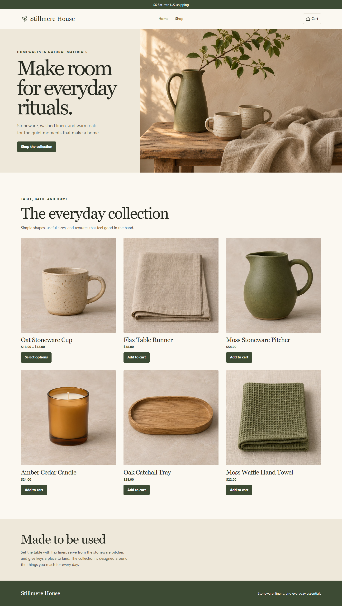

# Stillmere House

**Homewares storefront · WordPress and WooCommerce**

Stillmere House brings a collection of stoneware, linen, and oak into an online shop. Shoppers can browse six products across Table, Home, and Bath, choose a cup pack size, then review quantities and shipping before checkout.



## Project brief

Give a small homewares collection an editorial storefront with clear product choices and a straightforward guest checkout. Keep catalog and stock management in WooCommerce so the store can be maintained from WordPress.

## Implementation

- A custom storefront theme styles the homepage, catalog, product pages, cart, and checkout. The homepage is editable in the WordPress block editor.
- The Oat Stoneware Cup offers a **Single cup** at $18 and a **Set of two** at $32. WooCommerce tracks pricing and stock for each pack independently.
- The cart supports quantity updates and calculates $6 standard U.S. shipping. Guest checkout creates a WooCommerce order and updates inventory using the offline Cash on Delivery gateway.

This is an independent portfolio project for a fictional homewares brand. Checkout is configured for test orders.

## Run locally

Create a fresh local WordPress installation with PHP 8.1+ and MySQL or MariaDB. Check that your local server supports pretty permalinks. Set `PROJECT` to the absolute path of this checkout and run the following with WP-CLI from the WordPress root. On Windows, use Git Bash or copy the two directories with File Explorer and then run the WP-CLI commands.

```sh
PROJECT="/absolute/path/to/stillmere-house-woocommerce"
cp -R "$PROJECT/theme/stillmere" wp-content/themes/
cp -R "$PROJECT/plugins/stillmere-demo" wp-content/plugins/
wp plugin install woocommerce --activate
wp plugin activate stillmere-demo
wp theme activate stillmere
wp eval-file "$PROJECT/scripts/seed.php"
```

Open the URL printed by the seed script. The script builds the pages and catalog, attaches local images, and sets the shop currency, U.S. shipping, guest checkout, and offline gateway. It leaves previously seeded page and product content in place on a rerun. Store settings are applied each time.

Use a dedicated install. The offline checkout plugin permits only WooCommerce’s Cash on Delivery gateway and suppresses outbound WordPress mail. The cart and checkout use WooCommerce’s supported classic shortcodes and templates.

To test checkout, add the **Set of two** cup variation, change the cart quantity to two, and check out as a guest using sample details such as Taylor Example, 100 Sample Way, Portland, OR 97201, and `taylor@example.test`. Choose **Cash on delivery**. Confirm the $70.00 total and check the saved order under **WooCommerce → Orders**.

## Verification

Tested locally in Chromium at 1440×1000 and 390×844 with WordPress 7.1.5, WooCommerce 11.3.1, and PHP 8.3.37 using the WordPress SQLite integration. Verified all six product routes, both variation prices, add to cart, a quantity update from one to two packs, mobile navigation and checkout layout, and a complete desktop guest checkout. WooCommerce saved the $70.00 order as Processing via Cash on Delivery, recorded $6.00 shipping, and reduced the selected variation’s stock by two. A seed rerun preserved the six-product catalog and remaining stock.

[Desktop home](screenshots/desktop-home.png) · [Mobile home](screenshots/mobile-home.png) · [Mobile variable product](screenshots/mobile-product.png) · [Mobile checkout](screenshots/mobile-checkout.png)

## Data and imagery

- `data/home.html` contains the homepage’s editable WordPress blocks.
- `data/products.json` contains product descriptions, SKUs, prices, and variation stock.
- `data/images/` contains the catalog photos imported into the media library by the seed script.
- The original images were generated with OpenAI ImageGen. The hero brief was a moss-green pitcher, oat stoneware cups, and flax linen on a warm oak table. The catalog brief was six centered product photographs of a cup, runner, pitcher, candle, tray, and towel against pale natural materials.

See [WP-CLI installation](https://make.wordpress.org/cli/handbook/guides/installing/), [WooCommerce classic page shortcodes](https://woocommerce.com/document/woocommerce-shortcodes/page-shortcodes/), and [WooCommerce Cash on Delivery](https://woocommerce.com/document/cash-on-delivery/).
